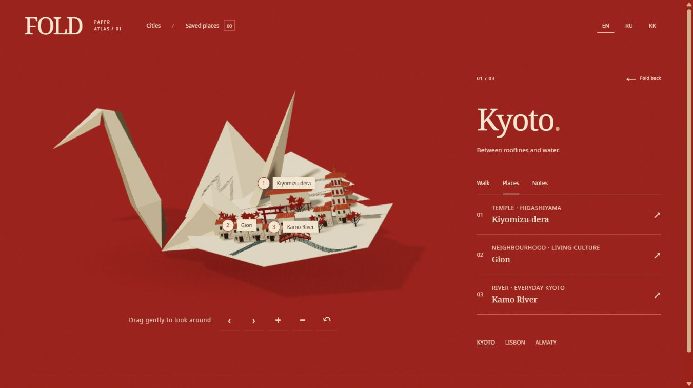

# FOLD

**Unfold somewhere.** An interactive paper atlas by Beibars Ileskhan: one origami crane opens into three small worlds, with nine stories to discover and keep.

[Review the coherent-journey revision](https://seoshiro.github.io/fold/review/) · [Previous FOLD preview](https://seoshiro.github.io/fold/) · [Portfolio](https://seoshiro.github.io/) · [Model source](model/fold-master.blend)



*Actual desktop WebGL screenshot, application revision `2397591`. This endpoint was completed with the explicit static-inspection control; it is not proof of motion quality.*

## One object, three places

Choose a printed fold, watch the same wing open, then explore a place, follow its three-stop guided view or save a story. Return folds the city into the crane rather than loading a new scene.

- **Kyoto:** Kiyomizu-dera, Gion and the Kamo River. Timber, quiet water and a temple stage.
- **Lisbon:** Alfama, Tram 28 and Belém Tower. Terracotta rooftops, a yellow tram and the waterfront.
- **Almaty:** Ascension Cathedral, Green Bazaar and Kok Tobe. A tree-lined city under a mountain silhouette.

The arrangement is an artistic paper interpretation, not a geographic map. The guided view is a sequence inside the atlas, not a physical walking route. Stories link to official sources; no invented opening hours, prices or accessibility guarantees. [Content sources](docs/sources.md)

## Explore without instructions

- Select cities and places directly on the model or through ordinary HTML buttons.
- Drag horizontally to inspect the crane. Rotate, zoom and reset buttons provide alternatives; vertical touch gestures remain page scrolling.
- English, Russian and Kazakh are complete interface/content choices. Language and saved places stay in this browser.
- A place has its own shareable URL, including its source tab and guided-view stop. Browser history records city, tab, stop, scroll and semantic focus; Escape closes a story, city or utility panel. See the revision QA log for actual browser validation.
- The opening can be skipped and does not repeat on returning from a city. System reduced-motion preferences use short transitions.
- When WebGL or the model cannot load, actual-model posters preserve the atlas, all stories and saved places. Retrying 3D preserves the selected content.

Saved places are local to the browser, not an online account. There is no audio autoplay, payment flow, location tracking or analytics.

## How it is built

React + TypeScript + Vite provide the accessible interface. One persistent Three.js scene renders the object. GSAP animates a shared pose, so a new choice interrupts the current motion without remounting the canvas. Fold pivots, city geometry and label anchors come from the original Blender source.

- Editable, texture-packed `.blend` and optimized GLB are included.
- **48 independent architecture hinges**, **25,692 model triangles**, **1,404,220-byte GLB**. These are asset measurements, not performance claims.
- The web renderer sleeps between interactions; pixel ratio is bounded. Self-hosted Noto fonts include Kazakh characters.
- The model is an art-directed pop-up construction, not a physically certified design made from a single uncut square. No cloth or exact collision simulation is claimed.

[Model preparation and limits](model/README.md) · [Build notes](docs/BUILD_PLAN.md) · [Original browser verification](docs/QA.md) · [Revision verification](docs/QA_REVISION.md)

## AI, authorship and materials

FOLD is a self-directed, AI-assisted portfolio concept. Its supplied visual references establish the direction. The crane, city architecture, folding mechanism and application are original procedural geometry and code, not an image tilted to imitate 3D.

One **Higgsfield GPT Image 2.6** operation produced fine paper fibers used by the real material. The original, prompt, parameters, quote and local processing record are preserved. It cost **2.75 credits** from FOLD's separate 150-credit limit. No generated video or paid 3D model was needed. The remaining budget is not a spending target.

[Report in Russian](docs/DELIVERY_RU.md) · [Material provenance](assets/higgsfield/fold-paper-001/provenance.json) · [Generation ledger](docs/generation-ledger.json)

## Coherent journey revision

The review edition retains the existing atlas and makes one pose responsible for the unfolding model and its semantic HTML story leaf. The same story remains present while folding back to its place. Text changes at shared scene milestones; fallback images are decoded before the accompanying content commits. Mobile has stable canvas dimensions and a tighter geometry-fitted camera. Labels use complete measured rectangles, inter-label and geometry exclusions, with accessible list controls always available.

Kyoto has a wider temple hall and veranda; Lisbon has stepped hillside cards, a distinct tram and broader Belém silhouette. The opening now articulates the real wing attachment. No new paid generation was used. The original source remains recoverable in `checkpoint/pre-journey-review`; updated source work is in `revision/coherent-journey`.

[Revision plan and acceptance gates](docs/REVISION_PLAN.md) · [Navigation contract](docs/NAVIGATION_INTEGRATION.md)

## Run locally

Use Node 24 LTS (the pinned test runner also supports Node 22.12+).

```bash
npm ci
npm run dev
npm test
npm run build
```

The default build uses `/`. For the published GitHub Pages project path:

```bash
VITE_BASE=/fold/ npm run build
```

GitHub Pages serves `docs/` on `main`. The original preview remains at the root for comparison. The new revision is published separately in `docs/review/`, built with `VITE_BASE=/fold/review/`. Do not publish a stale `dist/` over newer source changes. Model rebuilding additionally needs Blender 4.3+ and Python; see the model instructions above.

## Verification and honest limits

Fifty-five source tests cover content completeness, locale key parity, URL validation, resilient storage, full history context, measured label bounds, poster races and deterministic GSAP retargeting continuity. The latter exercise actual scene methods without WebGL; they are not a browser motion recording. Actual browser checks are recorded separately with their preview revision, conditions and remaining gaps. A successful build or screenshot is not presented as proof of smooth motion. Mobile viewport tests are emulation, not a claim of physical phone or Safari testing. Translations have not been reviewed by a native-speaker panel.

The public preview is available, with source models and static browser evidence. Functional flows and keyboard corrections have been checked as described in the QA log. **Final motion acceptance remains open:** no continuous browser recording was obtained, and a 20-second sample was invalidated by browser throttling. Physical-phone performance, Safari, native 200% zoom and real context-loss recovery remain unverified. See [QA status](docs/QA.md) for exact versions and evidence. No screenshot or successful build substitutes for these checks.

No new blanket license is assigned here. Noto fonts retain their included SIL Open Font License. Generated material remains subject to the applicable service/provider terms.
